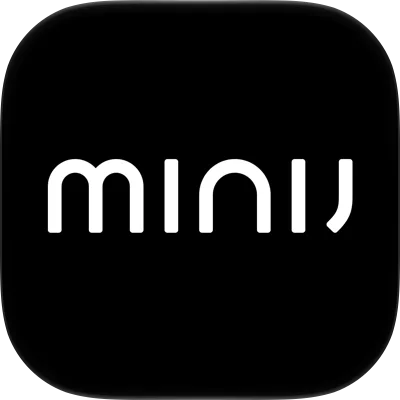

# 小吉 MiniJ · Home Assistant 集成

非官方的小吉云端状态监测集成。目前已在 **V6-XNB 壁挂洗烘机**
（内部型号 `minij.washer.x68`）上验证登录和状态读取。

这是限定机型的**云端状态监测集成**，稳定版范围限定于本文列出的监测功能。
实际已发布版本以 GitHub Releases 为准。仓库文档优先使用简体中文；
HA 界面跟随用户的语言设置，提供简体中文和英文。

## 已支持的功能

| 实体 | 内容 |
| --- | --- |
| 状态 | 已知别名按语言显示；内部状态和未知别名保持原样，保留原始状态文字 |
| 设备上报程序 | 控制器上报的程序名称 |
| 设备上报进程 | 控制器上报的阶段名称 |
| 童锁已开启 | 明确的 open/close 状态 |
| 云端控制已授权 | 明确的云端控制授权状态 |

以下为仓库 0.3 开发候选行为；0.2.0b1 已发布，稳定渠道仍为 0.1.1。

0.3 候选在 V6-XNB 上新增**设备上报剩余时间（分钟）**：只在明确工作时显示，
空闲或其他/缺失状态为未知；无效值为未知，读取失败为不可用，不做本地倒计时。
原五个实体保持。时间单位已有本次真实 App/API 对照，暂停及完整周期仍待验证。

0.3.0b2 候选另增**设备通知**事件实体：从官方设备消息读取洗衣完成、清洁完成和故障提醒，
V6-XNB 共七个实体。消息独立每分钟读取，首次/恢复只建立基线，旧消息不补报；
详见[完成通知与漏报边界](docs/releases/0.3.0b2.md)。

正常每 60 秒共享一次设备列表请求，连续失败逐步退避至 900 秒，限流至少等待 300 秒，
有效的 `Retry-After` 可延长等待；成功后恢复 60 秒。手动刷新可能提前发起读取。成功读取时同步云端设备名称、型号和固件，
保留 HA 自定义名称、区域及既有标识。未知开关值显示为未知；云端刷新失败或设备解绑时，
实体显示为不可用。更换凭据不会改变设备和实体的唯一标识。

程序和进程的“设备上报运行中”属性仅在 `working` 为 true、`resting` 为 false，
其他状态为 null；原上报值继续保留。诊断中的最近成功读取时间表示云端请求时间，
不是机器数据生成时间。0.2 的真实验收缺口见[可靠监测验收记录](docs/monitoring-acceptance.md)。

当前设备基线：Wi-Fi `1.0253`，设备固件 `0 0003 1 0000`。
已观察到 `resting`、`working` 和 `device_exception`。其他型号和固件尚待验证。

## 安装

推荐按照 [HACS 自定义仓库指南](docs/hacs-installation.md)安装和更新。
首个监测稳定版 [v0.1.1](https://github.com/ajaxjiang96/ha-minij/releases/tag/v0.1.1) 已发布；
后续版本请查看 [GitHub Releases](https://github.com/ajaxjiang96/ha-minij/releases)。
以下是手动安装方式：

需要 **Home Assistant 2026.10.4 或更新版本**。

1. 将仓库中的 `custom_components/minij` 完整复制到 HA 配置目录的
   `custom_components/` 下，包含 `translations/` 子目录。
   也可执行 `python scripts/package_integration.py`，将生成的 ZIP 解压到 HA 配置目录。
2. 重启 Home Assistant。
3. 打开 **设置 → 设备与服务 → 添加集成 → MiniJ**。
4. 选择**手机验证码（实验功能）**或**已有会话令牌（高级）**。
5. 手机号使用已有小吉账号的 11 位中国大陆号码，不带 `+86`。
   提交号码才会发送一条短信，再输入短信验证码即可。

验证码和令牌使用遮挡输入框。配置中只保存验证后的会话令牌，不保存手机号或验证码。
账号与设备访问检查失败时，“重试”只重复读取，不会再次发送短信或兑换验证码。
更换号码或重新获取短信需取消后重新开始，请避免重复请求。

已有条目可从 **⋮ → 重新配置** 更新认证，不需要删除设备；重新认证必须使用原账号。
账号所有者反馈短信流程可用，且本次登录后手机 App 仍能直接查看设备；
也已观察到 HA 启动后自动恢复，无需短信。长期有效期、其他会话轮换情形、
验证码冷却和额外验证仍未完整确认。遇到不支持的验证步骤，可使用自己的 App 会话令牌。
详见[登录验证指南](docs/sms-acceptance.md)和[认证证据](docs/authentication.md)。

源码：[ajaxjiang96/ha-minij](https://github.com/ajaxjiang96/ha-minij)。
HACS 自定义仓库无需等待默认列表收录。
稳定版范围和限制见[0.1.1 发布说明](docs/releases/0.1.1.md)与[支持政策](docs/support.md)。

## 当前本地验收版：0.4.0b4

按所有者要求，本次不发 Release，直接本地替换安装。解除运行状态、型号、固件和
云授权上报字段的人为门槛，默认启用控制；服务端认证及有效参数校验保持。
新增待启动程序草稿、随程序变化的参数，以及智能清洁设置/动作；详情见
[本地控制验收指南](docs/local-controls-0.4.md)。

提示音在 waiting 下已实测静音并恢复；本次诊断还观察到 working 下童锁开关的云端上报变化。
待启动程序是本地选择，不等于机器已切换。新增“唤醒（实验）”和“启动待选程序（实验）”，
请求来自断网 App 取证；所有者已确认本地 b4 的唤醒、启动和本轮参数有效。
启动不会自动唤醒或重发，暂停、继续、取消和关机正在研究。
程序/参数来自本机最新元数据，不用固定温度/转速数值猜协议。
Diagnostics 提供最近 30 条脱敏命令和缓存控制元数据，测试后先下载再重启。

## 当前限制

- **运行后回到空闲，不等于已确认正常完成。** 取消、停止等情况尚未区分；
  0.3.0b2 候选仅根据独立的官方完成消息产生事件，不根据回空闲或剩余时间 0 推断；
  通知由用户自行配置，故障/停机窗口不补报。
- 空闲时的程序和进程可能保留先前值，不能仅凭“主洗”“脱水”等文字判断仍在运行。
- 0.3 候选提供经本次 V6-XNB 对照的剩余分钟数；其他阶段、暂停和特殊值尚待完整核对，
  不提供预计结束时间。其他型号不据此启用时间实体。
- 可用性表示云端读取和设备绑定情况，尚不能代表设备的物理联网状态。
- `device_exception` 本身不能说明具体故障原因。
- 未假设令牌有效期或刷新接口；状态读取收到 HTTP 401/403 时进入重新认证。
- 当前本地版提供实验唤醒/启动，尚不提供暂停、继续、取消、关机、固件管理、局域网控制或 MQTT。

这些未提供的能力不属于首个监测版承诺。无需为了发布额外运行洗涤；
有正常使用机会时，再补充验证即可。

## 诊断与支持

MiniJ 条目的 **下载诊断信息** 提供已缓存的型号、固件和白名单状态字段，
不会额外轮询、发送短信或操作设备。MiniJ 数据部分不包含凭据或小吉标识符；
HA 会在外围添加系统信息，分享前请检查。

- [常见问题与更新方法](docs/troubleshooting.md)
- [安全的状态自动化示例](docs/automations.md)
- [支持范围与反馈政策](docs/support.md)
- [周期协议证据与缺口](docs/cycle-protocol.md)
- [MIoT 规格与参考库分析](docs/miot-reference.md)
- [0.4 提示音候选与只读证据](docs/prompt-tone-control.md)
- [0.4 实验童锁控制候选与验证方案](docs/child-lock-control.md)
- [日常洗涤观察指南](docs/cycle-validation.md)
- [完整集成路线图](docs/roadmap.md)：可靠监测、周期自动化、控制与多型号扩展
- [首个稳定版验收记录](docs/stable-release-checklist.md)
- [测试结果与证据边界](docs/validation.md)
- [开源基础状态](docs/foundation.md)
- [开发与贡献](CONTRIBUTING.md)

技术调查记录：[总览](docs/investigation.md)、[原生 HTTP](docs/native-http.md)、
[公开网页协议](docs/web-protocol.md)、[Android 运行证据](docs/runtime.md)、
[REA 工具](docs/rea-setup.md)。这些历史研究记录暂保留英文，面向用户的指南优先维护简体中文。

项目原创代码采用 [MIT 许可证](LICENSE)。用户提供的小吉图标和产品名称用于标识支持的产品，
不作为项目原创作品重新授权。本项目与小吉官方无关联。
